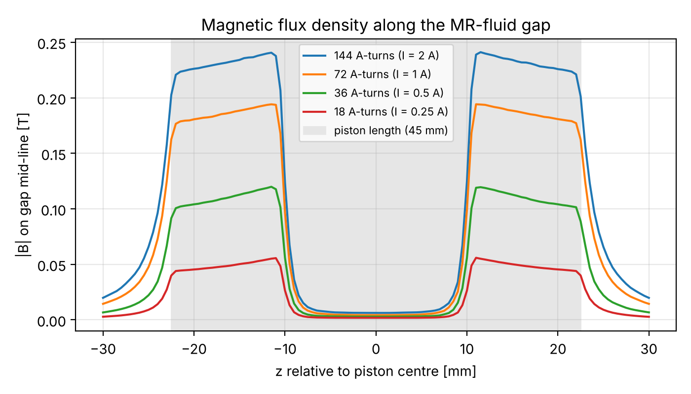
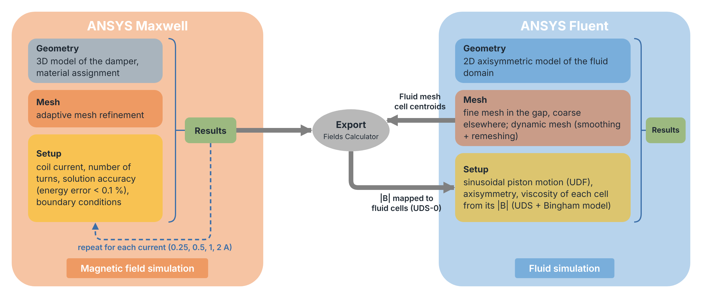
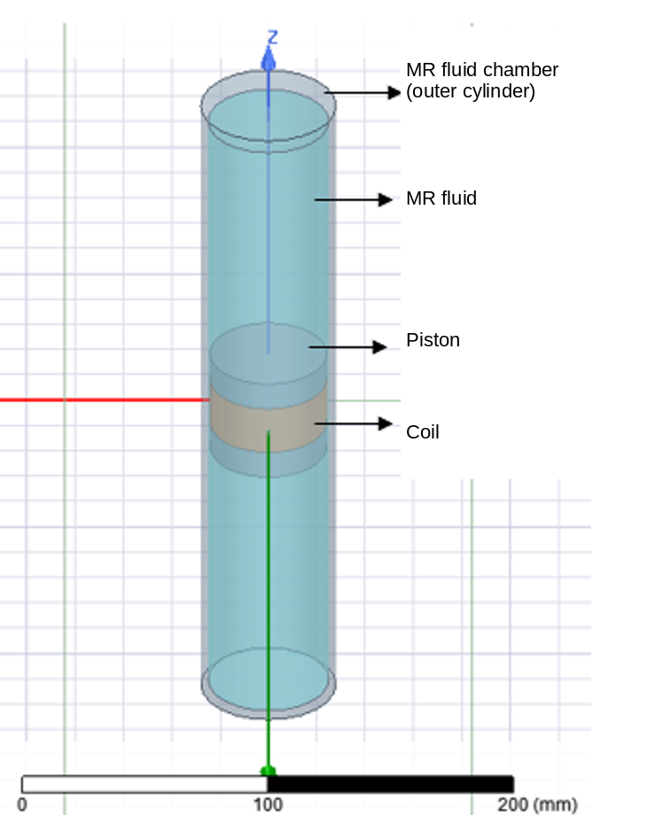
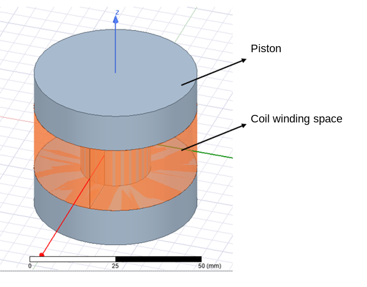
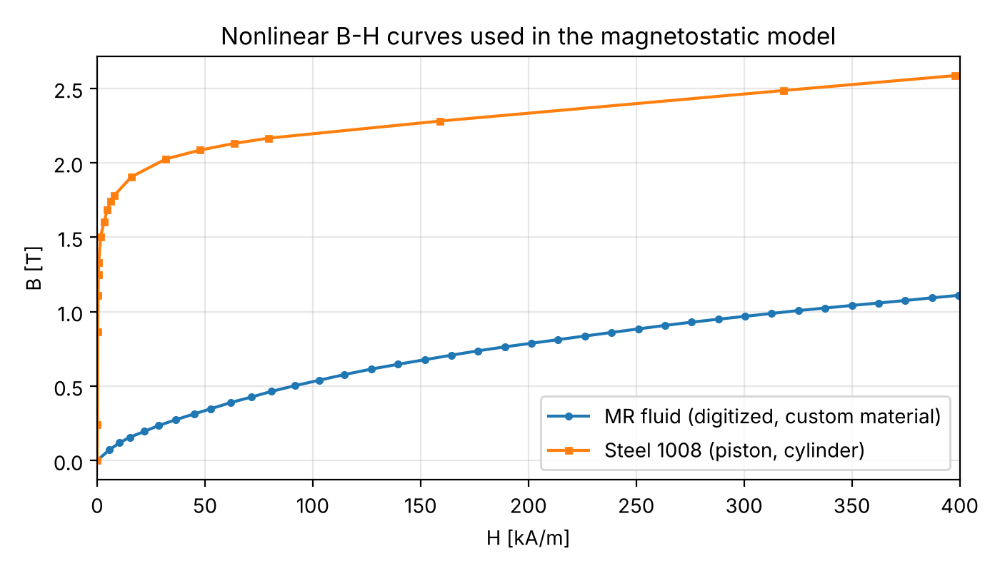
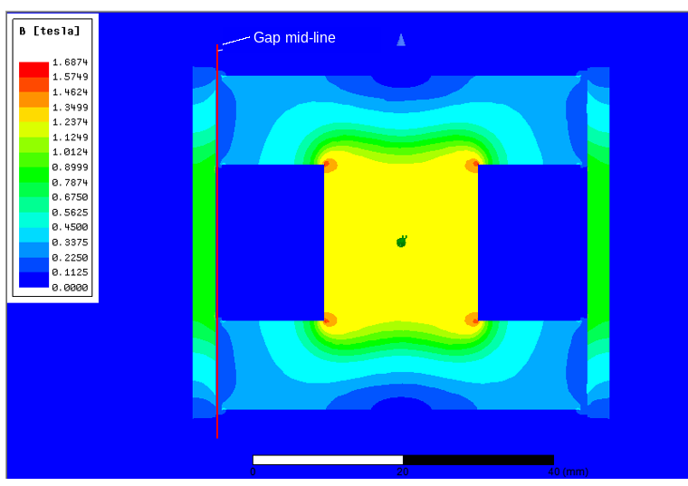
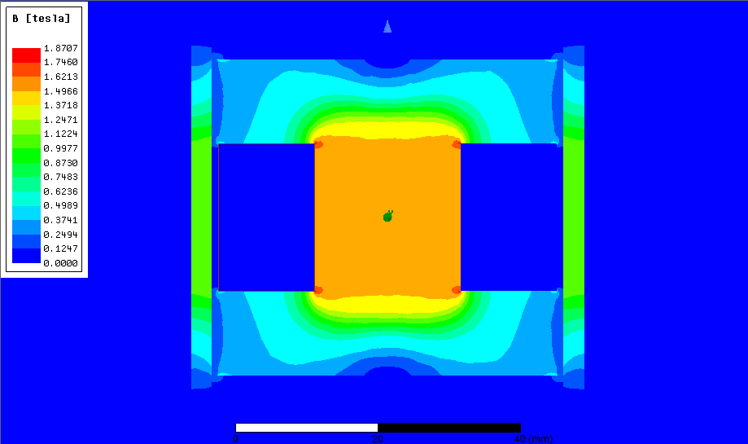
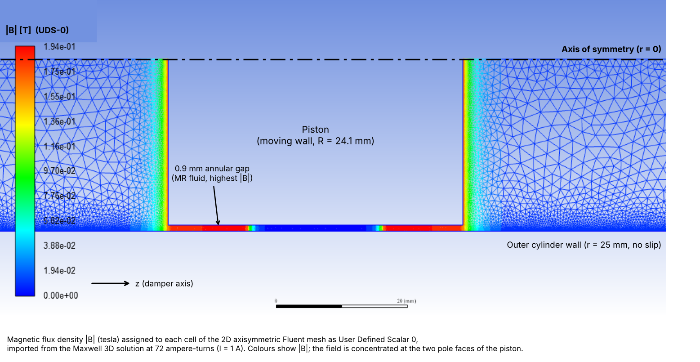
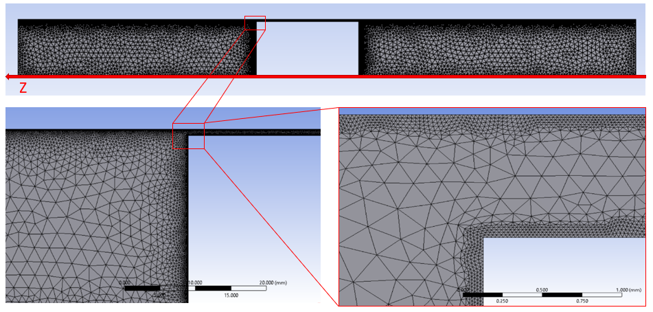

# MR Damper Multiphysics: Ansys Maxwell → Ansys Fluent field coupling

A magnetorheological (MR) damper resists motion more when a coil magnetizes the fluid in a 0.9 mm
gap around the piston. This project models that field in **Ansys Maxwell 3D** and carries it into
an **Ansys Fluent** model of the fluid, where it is stored cell by cell to drive the viscosity.

Internship project, Higher Institute for Applied Sciences and Technology (HIAST), Jul to Aug 2025.

## Highlights

- **Nonlinear 3D magnetostatic model**: steel 1008 B-H for the piston and cylinder, plus a custom
  MR-fluid material built from a digitized 56-point B-H curve. Solved at 4 coil currents
  (0.25, 0.5, 1 and 2 A).
- **Accurate in the 0.9 mm gap, cheap elsewhere**: converged to < 0.1 % energy error, with adaptive
  meshing that put 608 k of 1.68 M elements in the fluid (smallest edge 0.06 mm) and 87 k in the air.
- **Saturation quantified**: doubling the current raises the peak gap field 2.1× at low current
  but only 1.24× from 1 to 2 A, and the coil inductance falls from 32 to 20 mH. This set the
  1.5 A limit of the current driver.
- **Maxwell → Fluent field coupling**: Maxwell is solved once per current, not once per piston
  position. A UDF writes |B| into every Fluent cell as a User Defined Scalar (UDS) for the
  viscosity model to read. A full 2D map at all 107 450 Fluent cell centroids was also exported.



*|B| along the middle of the fluid gap. The field sits at the two pole faces of the piston, and the
gain per current step shrinks as the steel saturates.*

**Status**: the magnetic model, the saturation study and the field transfer into Fluent are complete
(the field shown in Fluent below is the imported result). The field-dependent viscosity
(Bingham model) and the moving-field UDFs are drafts in `fluent_udf/drafts/`.



## 1. Magnetostatic model (Ansys Maxwell 3D)

Project file: `maxwell/MR_damper_magnetostatic.aedt`, design `Maxwell3DDesign1`.

| Full damper model | Piston and coil |
|---|---|
|  |  |

| Part | Material | Size |
|---|---|---|
| Outer cylinder | Steel 1008, nonlinear B-H | outer R = 28 mm, bore R = 25 mm, L = 280 mm |
| MR fluid | **custom material `MR_fluid`**, 56-point nonlinear B-H curve | R = 25 mm, L = 270 mm |
| Piston (iron core) | Steel 1008, nonlinear B-H | R = 24.1 mm, L = 45 mm |
| Coil | Copper, stranded conductor | r = 10.39 to 24.1 mm, 21 mm long, wound in a groove of the piston |
| Air region | Vacuum | 100 % padding on every side |

- Radial fluid gap between piston and cylinder: **0.9 mm**.
- Excitation: stranded current on a cross-section of the coil, defined as `Amp*Turns`, so the
  ampere-turns can be swept as a design variable.
- Solved for **18, 36, 72 and 144 ampere-turns**, i.e. I = 0.25, 0.5, 1 and 2 A on the 72-turn coil.
- The B-H curve of the MR fluid was digitized from the published curve of the fluid with
  WebPlotDigitizer (`maxwell/materials/MR_fluid_BH_webplotdigitizer.json`) and added to Maxwell
  as a new material (`maxwell/materials/MR_fluid_BH_kA-per-m_T.csv`, H in kA/m, B in T).



### Solver settings: accuracy where it matters, cost kept low

| Setting | Value | Reason |
|---|---|---|
| Solver | Magnetostatic, nonlinear B-H, nonlinear residual 1e-3 | captures saturation of the steel and the MR fluid |
| Convergence | energy error < **0.1 %**, 30 % refinement per pass, max 25 passes | accurate field inside a 0.9 mm gap |
| Mesh | automatic initial mesh (~15 k tetrahedra) + adaptive refinement, curvilinear elements | elements are added where the field error is largest, not everywhere |

Adaptive refinement concentrated the elements in the gap. At 144 ampere-turns the final mesh had
1.68 M tetrahedra, 608 k of them in the MR fluid (smallest edge 0.06 mm) and only 87 k in the air
region. The solution converged in 17 to 19 passes (1 h 39 min at 144 ampere-turns).

| I (A) | Ampere-turns | Passes | Tetrahedra | Energy error | Stored energy E | L = 2E/I² |
|---|---|---|---|---|---|---|
| 0.25 | 18 | 17 | 0.99 M | 0.099 % | 0.99 mJ | 32 mH |
| 0.5 | 36 | 18 | 1.29 M | 0.089 % | 4.48 mJ | 36 mH |
| 1 | 72 | 19 | 1.68 M | 0.070 % | 15.7 mJ | 31 mH |
| 2 | 144 | 19 | 1.68 M | 0.059 % | 39.2 mJ | 20 mH |

The coil inductance follows from the stored magnetic energy, E = ½ L I², with I the current in the
72-turn coil. Because Maxwell's stranded excitation depends only on the ampere-turns N·I, the same
solution gives L for any number of turns: L = N² · 2E/(N I)². The inductance falls from about
32 mH to 20 mH at 2 A as the iron core saturates.

### Field distribution and saturation

| 72 ampere-turns (I = 1 A) | 144 ampere-turns (I = 2 A) |
|---|---|
|  |  |

*Section through the piston, damper axis vertical. Centre square: steel core inside the coil.
Dark blue rectangles on each side: the coil region. Thin green strips at the left and right edges: the steel
cylinder wall. The 0.9 mm fluid gap lies between the piston and the wall (red line in the left map).*

The gap-line plot at the top is |B| along the mid-line of the fluid gap (r = 24.55 mm, z from
-30 to +30 mm, 121 points), exported with the Fields Calculator for every excitation
(`data/gap_line/`).

- The field is concentrated at the two pole faces of the piston (|z| ≈ 11 to 22 mm) and is almost
  zero over the coil (|z| < 10 mm). Only the fluid passing the poles is activated.
- **Saturation**: doubling the current from 0.25 to 0.5 A raises the peak gap field 2.1×,
  from 0.5 to 1 A 1.6×, and from 1 to 2 A only 1.24× (0.194 → 0.241 T). The piston core reaches
  ≈ 1.6 T at 2 A, so the current driver was designed to stay below 1.5 A.

Plot generated by `scripts/plot_gap_line.py`.

## 2. Coupling the magnetic field to the fluid simulation

Re-solving Maxwell for every piston position would be very expensive. The field is solved
**once per current** in Maxwell, transferred to the fluid mesh, and stored per cell in Fluent as a
User Defined Scalar (UDS).



*Figure: magnetic flux density |B| (T) stored as User Defined Scalar 0 in every cell of the 2D
axisymmetric Fluent mesh, imported from the Maxwell solution at 72 ampere-turns (I = 1 A). The
colours show |B|. The field is strongest in the 0.9 mm annular gap at the two pole faces of the
piston, where it controls the apparent viscosity of the MR fluid.*

### Field used in the final Fluent run: gap-line profile

`fluent_udf/init_bfield.c` (`DEFINE_INIT`, compiled in the final Fluent system) reads
`fluent_udf/B_gap_midline_72At_z_B.txt`, the 72 ampere-turn |B| on the gap mid-line (z, |B|). It shifts z into the
Fluent frame (+0.104 + 0.0225 = 0.1265 m, the piston centre) and writes, for every cell, the
value at the nearest axial position into UDS-0. B is therefore treated as a function of the axial
position, B(z), which is the quantity that controls the flow resistance in the gap. This is why
the figure above shows vertical colour bands.

### Full 2D map at the fluid cell centroids (prepared alongside)

The data for a full 2D field map at the fluid cell centres was also produced:

1. **Fluent → Maxwell points.** The cell centroids of the 2D fluid mesh (107 450 cells) are
   exported from Fluent (`data/coupling/01_fluent_cell_centroids.csv`) and moved into the Maxwell
   frame: `Z = x - 0.1265`, `Y = y - 0.025`, `X = 0` (`scripts/fluent_to_maxwell_points.py`).
2. **Maxwell Fields Calculator** evaluates `Mag_B` exactly at those points
   (`data/coupling/03_maxwell_MagB_at_centroids_72At.txt`). Because the sample points are the fluid
   cells themselves, the field resolution follows the CFD mesh: fine (0.1 mm) in the gap and
   coarse (2 mm) where the fluid is nearly still.
3. **Table for the UDF**: `x y B` (`scripts/maxwell_export_to_uds.py`,
   `data/coupling/04_Finaluds_x_y_B.txt`). The UDF that reads it,
   `fluent_udf/drafts/init_2D_centroid_map_attempt.c` (nearest neighbour in x and y), is a draft
   that was not used in the final run.



*Fluent mesh: 0.1 mm cells in the gap, about 2 mm cells where the fluid is nearly still.*

### Other UDFs

- `fluent_udf/piston_motion_2D.c`: `DEFINE_CG_MOTION`, sinusoidal piston motion (1 cm, 1 Hz) with
  smoothing and remeshing dynamic mesh.
- `fluent_udf/drafts/viscosity_and_moving_field_drafts.c` (drafts, several UDFs in one file):
  - `DEFINE_PROPERTY`: viscosity of each cell from its UDS value with the Bingham model
    η = τy(B)/γ̇ + η_p, τy = aB + bB², with a lower bound on γ̇ to avoid division by zero.
  - `DEFINE_ON_DEMAND` + `DEFINE_ADJUST`: shift the field lookup by the current piston position at
    every time step, so the field moves with the piston.
- `fluent_udf/drafts/piston_motion_3D_early.c`: an earlier 3D version of the motion UDF.

This is a one-way coupling: the field changes the fluid properties, and the effect of the particle
chains on the field is neglected.

## Repository layout

```
maxwell/            .aedt project (geometry, materials, setup; results not included)
maxwell/materials/  MR-fluid B-H curve and the WebPlotDigitizer project
data/gap_line/      |B| on the gap mid-line for 18 / 36 / 72 / 144 ampere-turns
data/coupling/      Fluent centroids → Maxwell points → |B| export → UDF table
fluent_udf/         UDFs used in the final run and the gap-line table they read
fluent_udf/drafts/  earlier and unfinished UDFs, kept for reference
scripts/            Python scripts that rebuild the plots and the coupling files
figures/            result images
```

The `.aedtresults` folder (several GB) is not included. Open the `.aedt` in Ansys Electronics
Desktop and run *Analyze All* to regenerate it.

```
pip install -r requirements.txt
python scripts/plot_gap_line.py
python scripts/plot_bh_curves.py
```
